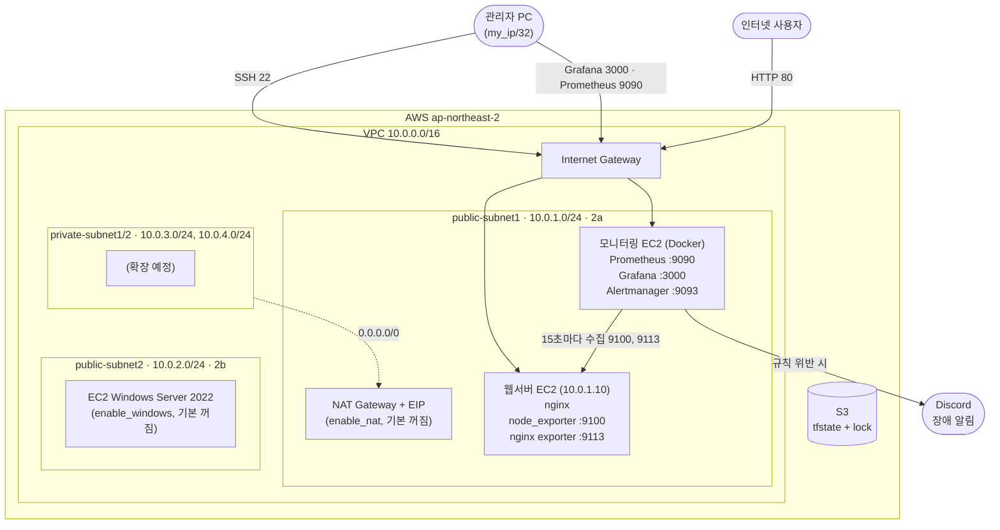
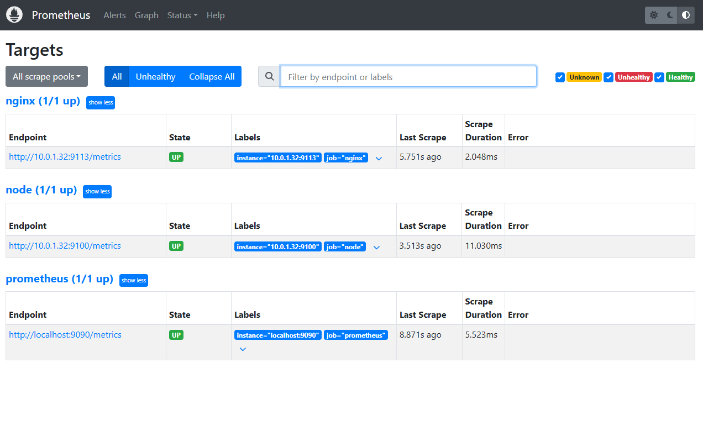
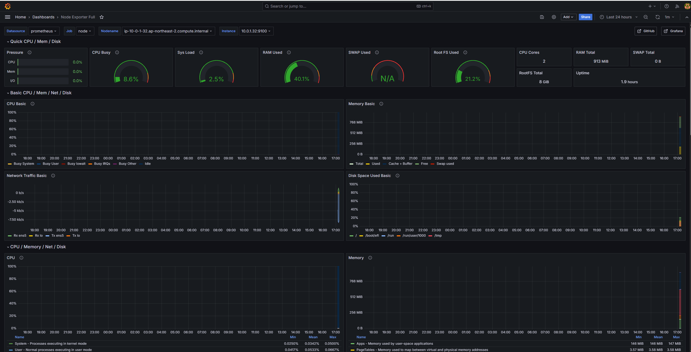
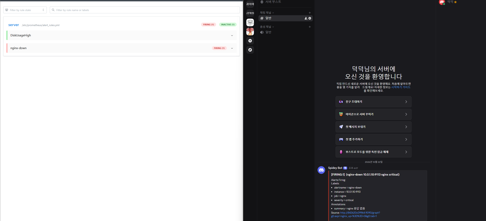

# AWS Lab: Terraform으로 구축한 AWS 인프라와 장애 감지·대응 실습

Terraform으로 서울 리전에 VPC 네트워크와 EC2를 코드로 구축하고,
그 위에서 **실무에서 자주 발생하는 서버 장애를 재현해 원인을 추적하고 해결한 과정**을 문서로 기록한 저장소입니다.

이후 **Prometheus, Grafana, Alertmanager로 모니터링 서버를 추가**해서, 고객 문의로 알게 되던 장애를 **알림으로 먼저 감지**하도록 확장했습니다.


## 구성도



## 기술 스택

| 분류 | 사용 기술 |
|---|---|
| IaC | Terraform ≥ 1.10, AWS Provider ~> 6.66 |
| State 관리 | S3 원격 백엔드 + S3 네이티브 잠금(`use_lockfile`) |
| 네트워크 | VPC, 퍼블릭/프라이빗 서브넷(2 AZ), IGW, NAT Gateway(선택), 라우팅 테이블 |
| 컴퓨팅 | EC2 Amazon Linux 2023 (웹서버, 모니터링 서버), Windows Server 2022(선택) |
| 웹 서버 | nginx (`user_data`로 부팅 시 자동 설치) |
| 모니터링 | Prometheus v3, Grafana 11, Alertmanager, node_exporter, nginx-prometheus-exporter |
| 알림 | Alertmanager → Discord 웹훅 |
| 컨테이너 | Docker, Docker Compose (모니터링 서버) |
| 운영 | systemd, journalctl, lsof, nginx 로그 분석, Linux 권한 관리 |

## 설계 포인트

- **관리 포트 최소 개방:** SSH(22)와 RDP(3389), Grafana·Prometheus·Alertmanager 화면은 `my_ip` 변수의 `/32` 대역만 허용합니다. 변수 `validation`으로 `/32`가 아닌 값은 막습니다. HTTP(80)만 전체에 공개합니다.
- **수집 포트는 모니터링 서버에만:** 웹서버의 exporter 포트(9100, 9113)는 IP가 아니라 **모니터링 서버의 보안 그룹**을 출발지로 허용합니다(`security_groups` 참조). 모니터링 서버의 IP가 바뀌어도 규칙을 고칠 필요가 없습니다.
- **비용 스위치:** 쓰지 않는 유료 리소스는 지우지 않고 `count = var.enable_x ? 1 : 0`으로 끌 수 있게 했습니다(`enable_nat`, `enable_windows`, 기본 false). 꺼진 리소스를 참조하는 라우트와 output도 `[0]`, `one()`, 조건식으로 함께 처리했습니다.
- **웹서버 사설 IP 고정:** 매일 `destroy`/`apply`를 반복하면 사설 IP가 바뀌어 Prometheus 설정을 고쳐야 했습니다. `private_ip = "10.0.1.10"`으로 고정해 설정 파일을 그대로 쓸 수 있게 했습니다.
- **민감 정보 분리:**
  - 내 IP는 `terraform.tfvars`에 두고 `.gitignore`로 제외합니다.
  - Discord 웹훅 URL은 저장소에 올리지 않고, 서버에서만 `alertmanager.yml`에 넣습니다.
  - Windows 키는 로컬에서 `ssh-keygen`으로 만들고 **공개키만** 등록합니다.
  - Windows 관리자 비밀번호는 state에 남지 않도록 로컬 AWS CLI로 복호화합니다.
- **인스턴스 보안 기본값:** IMDSv2 강제(`http_tokens = "required"`), 루트 볼륨 gp3 암호화를 적용했습니다.
- **재생성 안정성:**
  - AMI는 AWS 공식 SSM 파라미터로 최신 이미지를 조회합니다.
  - `ignore_changes = [ami]`로 새 AMI가 나와도 인스턴스가 다시 만들어지지 않게 했습니다.
- **리팩터링 안전성:** 리소스 이름을 바꿀 때 `moved` 블록을 써서, 리소스를 지우고 다시 만들지 않고 state 주소만 옮겼습니다.
- **비용 관리:** 실습이 끝나면 `terraform destroy`로 전체를 정리하고, 다음 날 `apply`로 같은 환경을 복원합니다.

## 모니터링과 알림

웹서버에는 수치를 내놓는 **exporter**만 두고, 모니터링 서버의 **Prometheus**가 15초마다 가져가 저장합니다. 규칙에 걸리면 **Alertmanager**가 Discord로 알리고, **Grafana**로 화면을 봅니다.

| 구성 요소 | 위치 | 역할 |
|---|---|---|
| node_exporter `:9100` | 웹서버 (`user_data`로 설치) | CPU, 메모리, 디스크 수치 |
| nginx-prometheus-exporter `:9113` | 웹서버 (`user_data`로 설치) | nginx 상태(`nginx_up`), 접속 수. nginx `stub_status`를 127.0.0.1에서만 읽음 |
| Prometheus `:9090` | 모니터링 서버 (Docker) | 수집, 저장, 알림 규칙 검사 |
| Alertmanager `:9093` | 모니터링 서버 (Docker) | 알림 묶음, Discord 전송, 해결(RESOLVED) 알림 |
| Grafana `:3000` | 모니터링 서버 (Docker) | 대시보드 (Node Exporter Full, `monitoring/grafana/`) |

### 알림 규칙 (`monitoring/alert_rules.yml`)

| 알림 | 조건 | 지속 | 등급 | 잡는 상황 |
|---|---|---|---|---|
| `DiskUsageHigh` | 루트 디스크 사용률 > 85% | 1분 | warning | 디스크 가득 참 (07번) |
| `nginx-down` | `nginx_up == 0` | 1분 | critical | nginx가 멈춤 (08번) |
| `TargetDown` | `up == 0` | 1분 | critical | 서버나 exporter가 통째로 응답 없음. 이때는 `nginx_up` 값 자체가 사라져서 위 규칙으로는 못 잡음 |

- `for: 1m`: 수집 주기(15초)의 4배. 한 번 튄 값으로 critical 알림이 울리지 않게 합니다.
- 실측 결과, 장애 발생부터 Discord 알림까지 **약 2분**이 걸렸습니다.







### 구축하면서 겪은 문제

| 문제 | 원인 | 해결 |
|---|---|---|
| exporter 포트로 수집이 타임아웃 | 9100·9113 규칙을 웹서버가 아닌 다른 보안 그룹에 넣음 | 받는 쪽(웹서버) 보안 그룹으로 옮기고 출발지를 모니터링 SG로 지정 |
| 웹서버 IP가 매번 바뀌어 설정을 고쳐야 함 | `destroy`/`apply`마다 사설 IP 재할당 | 처음엔 exporter를 모니터링 서버의 컨테이너로 옮겼으나 **모니터링 서버 자신을 감시**하게 됨 → 되돌리고 Terraform에서 웹서버 사설 IP를 고정 |
| 알림이 오지 않음 | Alertmanager 서비스 누락, 규칙 파일 오타(`annotaions`)와 경로 오류 | compose에 서비스 추가, 오타·경로 수정 |
| `docker compose up` 시 `mapping key already defined` | YAML 들여쓰기가 한 단계 깊어 다른 서비스 안으로 들어감 | 들여쓰기 수정, `docker compose config --quiet`로 검사 |

## 장애 대응 실습 (Troubleshooting)

Linux EC2에 장애를 일부러 발생시키고, **증상이나 알림만 보고** 원인을 찾아 해결했습니다.
각 문서는 **상황 → 증상 → 로그 분석 → 원인 → 조치 → 재발 방지** 순서로 작성한 장애 보고서(포스트모템) 형식입니다.

| # | 장애 | 감지 | 핵심 원인 | 사용한 도구 |
|---|---|---|---|---|
| 1 | [서버에 파일이 저장되지 않음](troubleshooting/01-disk-full.md) | 사용자 문의 | 앱 디버그 로그가 디스크 100% 점유 | `df`, `du`, `truncate`, logrotate |
| 2 | [설정 변경 후 웹사이트 접속 불가](troubleshooting/02-config-syntax.md) | 사용자 문의 | nginx 설정 `;` 누락 + 검사 없이 restart | `journalctl`, `nginx -t`, `reload` vs `restart` |
| 3 | [배포 후 403 Forbidden](troubleshooting/03-permission.md) | 사용자 문의 | `mv`로 600 권한이 그대로 따라옴 | error/access log, `ls -l`, `ps`, `install` |
| 4 | [야간 점검 후 홈페이지가 이상한 페이지로 바뀜](troubleshooting/04-port-conflict.md) | 사용자 문의 | 다른 웹 서버(Apache)가 80번 포트 선점 | `ss -tlnp`, `dnf history`, `systemctl disable`, 재부팅 검증 |
| 5 | [서버는 정상인데 외부에서 접속 불가](troubleshooting/05-network.md) | 사용자 문의 | 보안 그룹을 Terraform 밖에서 수정 (drift) | `Test-NetConnection`, `tcpdump`, `terraform plan/apply`, CloudTrail |
| 6 | [정기 재부팅 후 웹 서버가 켜지지 않음](troubleshooting/06-boot.md) | 사용자 문의 | 로그 폴더를 재부팅 시 비워지는 `/run`(tmpfs)에 둠 | `journalctl -b -1`, `findmnt`, `df`, 재부팅 검증 |
| 7 | [디스크 사용량 경고 알림](troubleshooting/07-disk-alert.md) | **알림 (2분)** | 배치 서비스가 5.8GB 파일을 계속 쓰며 디스크 94% | `df`, `du`, `lsof`, `ps`, `systemctl stop/disable` |
| 8 | [홈페이지가 가끔 안 열림](troubleshooting/08-nginx-periodic-stop.md) | **알림 (2분)** | 4분마다 도는 정리 작업 스크립트가 nginx를 중지 | `systemctl status`, `journalctl`(UTC), audit `auid`, `systemctl list-timers` |

1~6번은 사용자가 문제를 알린 뒤에 진단을 시작했고, 7~8번은 모니터링 알림으로 **먼저 감지**했습니다. 7~8번은 발생부터 복구까지의 타임라인과 회고를 함께 기록했습니다.

전체 목록과 진행 방법: [troubleshooting/README.md](troubleshooting/README.md)

> 장애 시나리오는 AI 도구(Claude, Claude Code)로 만들어 실습 서버에 발생시켰습니다. 7~8번은 장애 스크립트의 내용을 보지 않고 실행했습니다. 진단과 해결은 제가 직접 서버에 접속해 수행했습니다.

## 디렉터리 구조

```
.
├── backend.tf            # S3 원격 state + 잠금
├── terraform.tf          # Terraform, Provider 버전 고정
├── main.tf               # AWS provider (ap-northeast-2)
├── variables.tf          # my_ip(검증 포함), 인스턴스 타입, enable_nat / enable_windows 스위치
├── vpc.tf                # VPC, 퍼블릭/프라이빗 서브넷 x2
├── IGW.tf / route.tf     # 인터넷 게이트웨이, 퍼블릭 라우팅
├── nat.tf                # NAT Gateway, 프라이빗 라우팅 (enable_nat)
├── security_group.tf     # 웹서버, 모니터링 서버, Windows 보안 그룹
├── ec2_linux.tf          # 웹서버: AL2023 + nginx + exporter user_data, 사설 IP 고정
├── ec2_monitoring.tf     # 모니터링 서버: AL2023 + Docker, Compose user_data
├── ec2_windows.tf        # Windows Server 2022 + 키 페어 (enable_windows)
├── outputs.tf            # 접속 IP, SSH 명령, Grafana·Prometheus 주소
├── moved.tf              # 리소스 이름 변경 이력
├── keys/windows.pub      # Windows 키 페어 공개키 (개인키는 저장소에 없음)
├── monitoring/
│   ├── docker-compose.yml   # Prometheus, Grafana, Alertmanager
│   ├── prometheus.yml       # 수집 대상, 규칙 파일, Alertmanager 주소
│   ├── alert_rules.yml      # 알림 규칙 3개
│   ├── alertmanager.yml     # Discord 전송 (웹훅 URL은 비워 둠)
│   ├── grafana/             # 대시보드 JSON
│   └── images/              # 모니터링 화면 캡처
├── docs/
│   ├── resources.md             # 리소스별 역할과 참조 관계 설명
│   ├── next-labs.md             # 다음 실습 계획 (Ansible 등)
│   └── server-monitoring-plan.md # 모니터링 확장 계획서
└── troubleshooting/      # 장애 대응 보고서와 캡처 이미지
```

## 실행 방법

사전 준비: Terraform ≥ 1.10, AWS CLI 인증, state용 S3 버킷, Linux용 EC2 키 페어(`linux`)

```bash
# 1. 내 공인 IP 설정 (반드시 /32, ipconfig의 사설 IP가 아님)
curl checkip.amazonaws.com
echo 'my_ip = "x.x.x.x/32"' > terraform.tfvars

# (선택) NAT Gateway, Windows가 필요할 때만
# echo 'enable_nat = true'     >> terraform.tfvars
# echo 'enable_windows = true' >> terraform.tfvars   # 이 경우 keys/windows.pub 필요

# 2. 배포
terraform init
terraform plan
terraform apply

# 3. 접속 정보 확인
terraform output
```

**모니터링 스택 실행** (웹서버 user_data가 끝날 때까지 2~3분 대기 후)

```bash
# 내 PC에서: 설정 파일을 모니터링 서버로 전송
scp -i linux.pem monitoring/*.yml ec2-user@<monitoring_public_ip>:~/monitoring/

# 모니터링 서버에서
cd ~/monitoring
nano alertmanager.yml          # webhook_url에 Discord 웹훅 URL 입력
docker compose up -d
docker compose ps              # prometheus, grafana, alertmanager 3개 Up
```

- Prometheus `http://<monitoring_public_ip>:9090` → Status → Targets에서 node, nginx가 UP인지 확인
- Grafana `http://<monitoring_public_ip>:3000` → 데이터 소스 `http://prometheus:9090` → `monitoring/grafana/node-exporter-full.json` import
- 설정 파일만 바꿨을 때는 `docker compose restart prometheus alertmanager`, compose 파일을 바꿨을 때는 `docker compose up -d`

```bash
# 4. 실습 종료 후 정리
terraform destroy
```

## 개선 예정

- [x] ~~CloudWatch Agent와 디스크 사용률 알람 (장애 #1 재발 방지)~~ → Prometheus + Alertmanager로 디스크 알림 구현 (장애 #7에서 검증)
- [x] ~~장애 대응 실습 5~6~~ → 완료, 7~8은 알림 기반으로 추가
- [ ] 웹 서버를 프라이빗 서브넷으로 옮기고 ALB 뒤에 배치 (현재 프라이빗 서브넷과 NAT는 확장용으로만 만들어져 있음)
- [ ] Ansible로 nginx 구성 자동화 (`validate: nginx -t -c %s` 적용)
- [ ] GitHub Actions로 `terraform fmt`, `validate`, `plan` 자동 실행
- [ ] root 액세스 키 대신 IAM 사용자 / IAM Identity Center 사용 (장애 #5에서 발견)
- [ ] 모니터링 스택 배포 자동화: `templatefile`로 user_data에서 설정 파일 생성과 `docker compose up`까지 처리
- [ ] Prometheus `--web.external-url` 설정 (알림의 Source 링크가 컨테이너 이름으로 나와 열리지 않음)
- [ ] Grafana 데이터 소스와 대시보드를 provisioning으로 코드화, 데이터 볼륨 연결
- [ ] 디스크 알림을 70% warning / 85% critical 두 단계로 분리, CPU·메모리 알림 추가
- [ ] 알림별 대응 매뉴얼(런북) 작성
- [ ] httpbin + k6로 응답 지연, 500 에러, 트래픽 급증 같은 서비스 레벨 장애 실습
