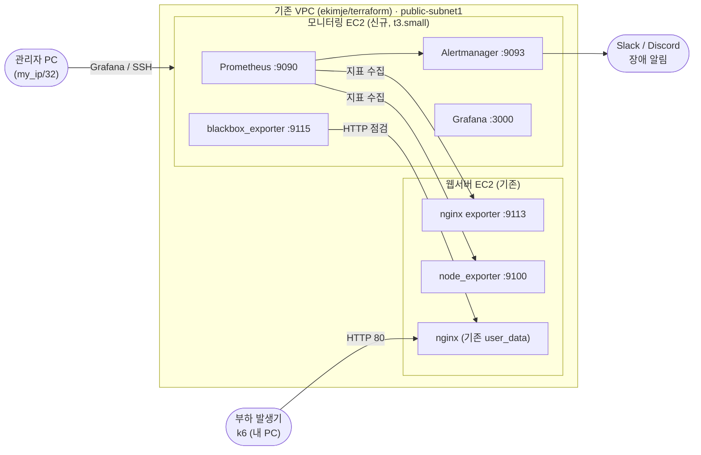

# 서버 관제 장애 대응 실습 프로젝트 계획서

> 작성: 2026-10-15 · 수정: 2026-10-20

## 개요

기존 [ekimje/terraform](https://github.com/ekimje/terraform) repo를 확장한다. 웹서버 EC2와 장애보고서 4건은 이미 있다. 여기에 모니터링 서버(Prometheus, Grafana, Alertmanager)를 붙여서 **증상을 보고 찾던 장애를 알림으로 먼저 감지**하게 바꾼다. 기존 코드와 보고서를 복습하면서 넣으므로 새로 만드는 것보다 시간이 덜 든다. 서버관제 직무 지원용 포트폴리오다.

| 항목 | 내용 |
| --- | --- |
| 기간 | 평일 저녁 하루 1~2시간, 단계당 하루씩 약 1주 |
| 목표 직무 | 서버관제 (장애 감지, 1차 대응, 전파, 보고) |
| 기반 | ekimje/terraform, `feature/monitoring` 브랜치에서 작업 |
| 추가 기술 | Docker Compose, Prometheus, Grafana, Alertmanager, blackbox_exporter, k6 |
| 산출물 | 기존 보고서 3건에 감지 섹션 추가, 새 장애보고서 3건, Grafana 대시보드, README 갱신 |

관제 직무는 장애를 직접 깊이 고치는 능력보다 **빠른 감지, 정확한 판단, 빠른 전파, 기록**을 본다. 프로젝트의 모든 결과물은 이 흐름이 보이도록 정리한다.

## 아키텍처

기존 Linux EC2(웹서버)는 그대로 쓰고, 모니터링 EC2 1대만 새로 추가한다. NAT Gateway와 Windows EC2는 이번 실습에 필요 없으므로 변수 스위치로 끈다.



| 파일 | 변경 | 내용 |
| --- | --- | --- |
| `variables.tf` | 수정 | `enable_nat`, `enable_windows` 변수 추가 (기본값 false) |
| `nat.tf`, `ec2_windows.tf` | 수정 | `count = var.enable_xxx ? 1 : 0`으로 끌 수 있게 변경. 코드는 지우지 않음 |
| `ec2_linux.tf` | 수정 | user_data에 node_exporter(:9100), nginx exporter(:9113), stub_status 설정 추가 |
| `ec2_monitoring.tf` | 신규 | 모니터링 EC2 (t3.small, AL2023, public-subnet1), user_data로 Docker 설치 |
| `security_group.tf` | 수정 | 모니터링 SG 추가 (22, 3000, 9090, 9093은 `my_ip`만). 웹 SG에 9100, 9113을 모니터링 SG에서만 허용 |
| `outputs.tf` | 수정 | Grafana, Prometheus 접속 URL 출력 추가 |
| `monitoring/` | 신규 | docker-compose.yml, prometheus.yml, alert_rules.yml, alertmanager.yml, blackbox.yml |
| `scenarios/` | 신규 | 새 시나리오용 장애 유발 스크립트, k6 스크립트 |

## 장애 시나리오

기존 장애 3건은 복습하며 다시 일으키고 감지만 추가한다. 새 장애 3건(05~07)은 처음부터 진행한다. 각 시나리오는 **장애 유발 → 알림 수신 시각 기록 → 원인 확인 → 조치 → 복구 확인** 순서로 한다. 기존 03(권한 403)은 감지 대상에서 빼고 그대로 둔다.

| # | 시나리오 | 구분 | 장애 유발 | 감지 지표 | 1차 조치 |
| --- | --- | --- | --- | --- | --- |
| 01 | 디스크 풀 | 기존 + 감지 | 기존 보고서의 디버그 로그 재현 | 루트 디스크 사용률 85% 초과 | `df`, `du`로 원인 파일 찾기, `truncate`, logrotate 확인 |
| 02 | nginx 설정 오류 | 기존 + 감지 | 설정에서 `;` 삭제 후 restart | blackbox `probe_success == 0` 1분 지속 | `journalctl -u nginx`, `nginx -t`, 수정 후 reload |
| 04 | 포트 선점 | 기존 + 감지 | Apache를 80번에 먼저 띄움 | blackbox 응답 본문 검사 실패 (200이어도 내용이 다르면 실패) | `ss -tlnp`, `systemctl disable httpd` |
| 05 | CPU 과부하 | 신규 | `stress-ng --cpu 2 --timeout 600s` | CPU 사용률 85% 초과 3분 지속 | `top`, `ps aux --sort=-%cpu`로 프로세스 찾기, 종료 |
| 06 | 메모리 부족 | 신규 | `stress-ng --vm 1 --vm-bytes 90% --timeout 300s` | 메모리 사용률 90% 초과 2분 지속 | `free -h`, `dmesg \| grep -i oom`으로 OOM 확인 |
| 07 | 트래픽 급증 | 신규 | 내 PC에서 k6로 가상 사용자 200명 | 응답시간 1초 초과 2분 지속, nginx 활성 접속 수 | 접속 로그에서 IP별 요청 수 집계, nginx `limit_req` 또는 보안그룹 차단 |
| 08 (선택) | 네트워크 지연 | 신규 | `tc qdisc add dev ens5 root netem delay 300ms` | 응답시간 증가 | `tc qdisc del dev ens5 root`로 복구 |

### 알림 규칙 (Prometheus PromQL)

```
# 02, 04. 서비스 다운 또는 본문 이상
probe_success{job="blackbox"} == 0

# 05. CPU 85% 초과
100 - avg by(instance)(rate(node_cpu_seconds_total{mode="idle"}[2m])) * 100 > 85

# 01. 디스크 85% 초과
(1 - node_filesystem_avail_bytes{mountpoint="/"} / node_filesystem_size_bytes{mountpoint="/"}) * 100 > 85

# 06. 메모리 90% 초과
(1 - node_memory_MemAvailable_bytes / node_memory_MemTotal_bytes) * 100 > 90

# 07. 응답시간 1초 초과
probe_duration_seconds{job="blackbox"} > 1
```

- 04번은 blackbox.yml의 http 모듈에 `fail_if_body_not_matches_regexp`로 내 홈페이지에만 있는 문구를 넣는다. Apache 기본 페이지가 뜨면 200이어도 `probe_success`가 0이 된다.
- 디스크 크기는 EC2 루트 볼륨 크기에 맞춰 유발 용량을 조정한다.
- 네트워크 인터페이스 이름은 `ip a`로 먼저 확인한다(ens5가 아닐 수 있음).
- 알림은 warning과 critical 두 단계로 나눠 보면 관제 등급 개념을 보여주기 좋다.

## 일정 (평일 저녁, 하루 1~2시간)

1단계에서 "Grafana에서 기존 웹서버 지표가 보이는 상태"까지 만드는 것이 가장 중요하다. 매일 끝날 때 `terraform destroy`, 다음 날 `apply`로 같은 환경을 다시 올린다.

### 1일차 — 복습과 비용 스위치

- [ ] repo 최신화, `feature/monitoring` 브랜치 생성, state용 S3 버킷이 남아 있는지 확인
- [ ] 복습: README, `docs/resources.md`, 각 .tf 파일을 훑으며 리소스 참조 관계 다시 정리
- [ ] `enable_nat`, `enable_windows` 변수 추가, `count` 적용
- [ ] `terraform plan`으로 NAT와 Windows가 생성되지 않는지 확인

### 2일차 — 모니터링 인프라

- [ ] `ec2_monitoring.tf`, 모니터링 SG 추가
- [ ] linux user_data에 node_exporter, nginx exporter 추가
- [ ] `terraform apply`, SSH 접속, `curl localhost:9100/metrics` 확인

### 3일차 — 모니터링 스택과 알림

- [ ] docker compose로 Prometheus, Grafana, Alertmanager, blackbox 실행
- [ ] Prometheus Targets 화면에서 모든 타깃이 UP인지 확인, 캡처
- [ ] Grafana에 Node Exporter Full(ID 1860) import, 관제용 요약 대시보드 1장 만들기
- [ ] 알림 규칙 작성, Alertmanager에 Slack 또는 Discord 웹훅 연결, 테스트 알림 1건 받기

### 4일차 — 기존 장애 재현 (복습)

- [ ] 기존 01, 02, 04 보고서를 다시 읽고 같은 장애를 일으킨 뒤 알림이 오는지 확인
- [ ] 알림 캡처, 대시보드 캡처 저장
- [ ] 기존 보고서에 "감지" 섹션 추가

### 5~6일차 — 신규 장애

- [ ] 05, 06, 07 실행, 시나리오마다 알림·대시보드·조치 결과 캡처
- [ ] 아래 양식대로 장애보고서 새로 작성

### 7일차 — 정리

- [ ] README 갱신: 구성도에 모니터링 서버 추가, 장애 표에 "감지 방법" 열 추가, 05~07 행 추가
- [ ] README 개선 예정 중 "디스크 사용률 알람"과 "장애 대응 실습 5~6" 체크 (CloudWatch 대신 Prometheus로 했다고 한 줄 설명)
- [ ] `feature/monitoring`을 main에 merge
- [ ] `terraform destroy` 후 AWS 콘솔에서 EC2, EBS, EIP가 남지 않았는지 확인
- [ ] 이력서와 잡코리아 포트폴리오 설명을 "장애 7건 재현, 감지, 대응"으로 갱신

## 장애보고서 양식

시나리오마다 이 양식으로 1장씩 쓴다. 관제 면접에서 가장 설득력 있는 산출물이므로 시각과 수치를 꼭 남긴다.

```markdown
# [장애보고서] 시나리오 N - 제목

| 항목 | 내용 |
| --- | --- |
| 장애 등급 | Critical / Warning |
| 발생 시각 | YYYY-MM-DD HH:MM |
| 감지 시각 | YYYY-MM-DD HH:MM (알림 수신) |
| 복구 시각 | YYYY-MM-DD HH:MM |
| 영향 범위 | 웹 서비스 접속 불가 등 |

## 1. 감지
- 어떤 알림이 어디로 왔는지 (캡처)
- 대시보드에서 보인 변화 (캡처)

## 2. 원인 확인
- 실행한 명령어와 결과

## 3. 조치
- 1차 조치 내용
- 실제 관제 환경이라면 누구에게 전파했을지 (담당 엔지니어, 고객사)

## 4. 복구 확인
- 지표 정상화, 알림 해제(resolved) 캡처

## 5. 재발 방지
- 임계치 조정, 자동화, 로그 로테이션 등
```

## 산출물과 주의사항

### 깃허브 repo 구조

```
terraform/  (ekimje/terraform, 추가·수정 부분만 표시)
├── README.md             # 수정: 구성도, 장애 표, 개선 예정
├── variables.tf          # 수정: enable_nat, enable_windows
├── nat.tf / ec2_windows.tf  # 수정: count로 끄기
├── ec2_linux.tf          # 수정: exporter 설치
├── ec2_monitoring.tf     # 신규
├── security_group.tf     # 수정: 모니터링 SG
├── monitoring/           # 신규: docker-compose.yml, prometheus.yml, alert_rules.yml, alertmanager.yml, blackbox.yml
├── scenarios/            # 신규: stress, k6 스크립트
└── troubleshooting/
    ├── 01-disk-full.md       # 수정: 감지 섹션 추가
    ├── 02-config-syntax.md   # 수정: 감지 섹션 추가
    ├── 04-port-conflict.md   # 수정: 감지 섹션 추가
    ├── 05-cpu-overload.md    # 신규
    ├── 06-memory-oom.md      # 신규
    └── 07-traffic-spike.md   # 신규
```

### 주의사항

- **비용**: NAT Gateway와 Windows EC2는 `enable_*` 변수로 꺼둔다. 매일 끝날 때 `terraform destroy`. 그 전에 캡처를 모두 받아둔다.
- **state 버킷**: 랜섬웨어 랩 준비 중 AWS 리소스를 정리했다면 state용 S3 버킷이 없을 수 있다. 1일차에 확인하고, 없으면 다시 만든다.
- **보안**: 모니터링 SG의 22, 3000, 9090, 9093은 기존 `my_ip` 변수(/32 검증)를 재사용해 내 IP만 허용한다. exporter 포트는 모니터링 SG에서만 받는다.
- **비밀값**: 웹훅 URL, Grafana 비밀번호는 `.env`에 두고 `.gitignore`에 추가한다.
- **브랜치**: main은 지금 상태 그대로 두고 `feature/monitoring`에서 작업한다. 중간에 멈춰도 main이 깨지지 않는다.
- **범위 조절**: 신규 시나리오가 밀리면 기존 3건 감지 추가와 README 갱신부터 마무리한다.
- **이후 계획**: 랜섬웨어 랩은 이 작업이 끝난 뒤 재개한다. 이번에 만든 Alertmanager를 탐지 단계로 그대로 가져다 쓴다.
