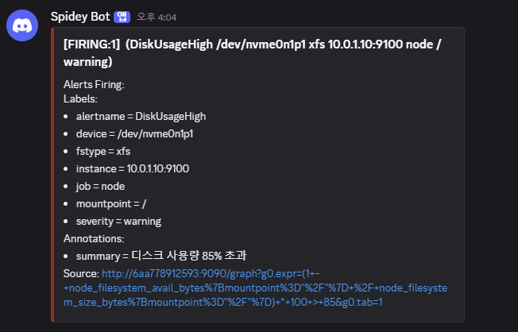
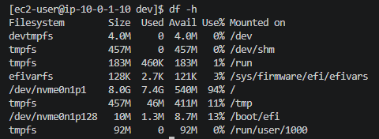
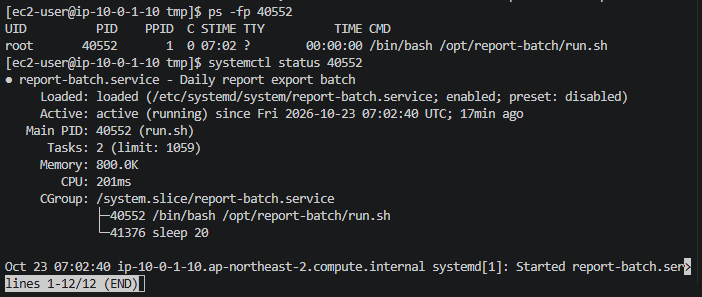
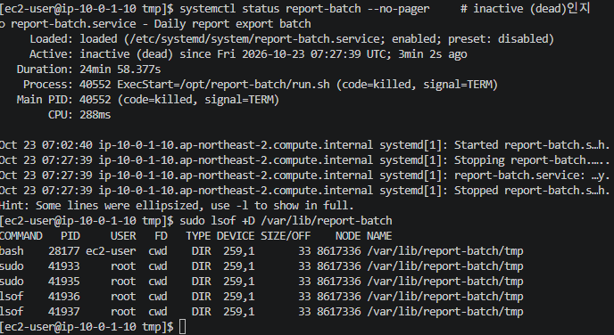
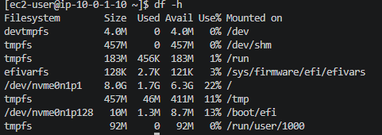
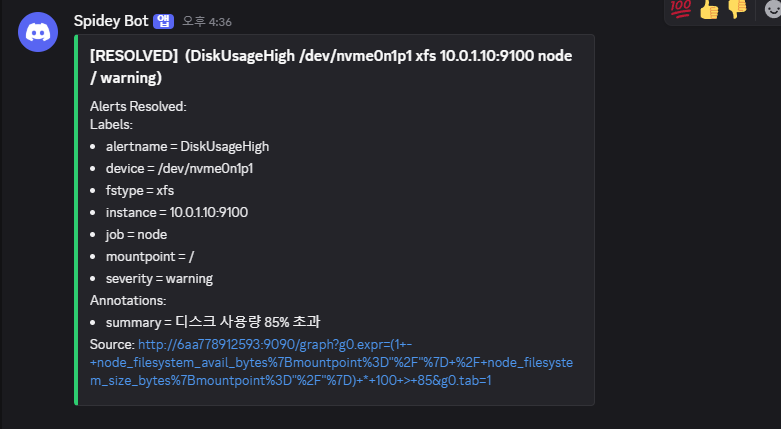

# 07. 디스크 사용량 경고 알림 (배치 작업이 대용량 파일 생성)

| 항목 | 내용 |
|---|---|
| 대상 서버 | `linux-ec2` (사설 IP 10.0.1.10, Amazon Linux 2023) |
| 발생 시각 | 2026-10-23 16:02 KST (서비스 시작 로그 07:02:40 UTC 기준) |
| 감지 | 16:04 Discord 알림 `DiskUsageHigh` (warning), **발생 후 2분** |
| 영향 | 루트 디스크 94% 사용. 그대로 두면 디스크가 가득 차 로그 기록과 파일 저장이 실패할 상황 |
| 상태 | 🟢 해결 (16:36 RESOLVED 알림, 발생 후 34분), 재발 방지 적용 (17:01) |

> 01번과 같은 "디스크 가득 참" 유형이지만, 이번에는 **고객 문의가 아니라 모니터링 알림으로 먼저 감지**했습니다. 장애 내용을 모르는 상태에서 알림만 보고 진단을 시작했습니다.

## 상황

> 관제 알림 (Discord):
> `[FIRING:1] DiskUsageHigh /dev/nvme0n1p1 xfs 10.0.1.10:9100 node / warning`
> "디스크 사용량 85% 초과"



알림에서 바로 읽을 수 있는 정보:

| 라벨 | 값 | 뜻 |
|---|---|---|
| `alertname` | DiskUsageHigh | 디스크 사용률 85% 초과 규칙 |
| `instance` | `10.0.1.10:9100` | **웹서버**의 node_exporter |
| `mountpoint` | `/` | 루트 디스크 |
| `severity` | warning | 서비스는 아직 동작, 곧 문제가 될 수 있음 |

## 해결 기록

> 캡처는 모두 장애 중에 직접 찍은 화면입니다. 서버 시각은 UTC라서 로그 시각에 9시간을 더하면 한국 시간입니다.

### 작성자 기록

| 항목 | 내용 |
|---|---|
| **원인** | `report-batch.service`(보고서 내보내기 배치)의 `run.sh`가 `/var/lib/report-batch/tmp/export_20261023.dat`(5.8GB)를 만들고 쓰기 모드로 계속 열어 둠. 루트 디스크 8GB 중 7.4GB 사용(94%) |
| **확인한 명령어** | `df -h`로 94% 확인 → `du -h -x --max-depth=1`로 `/` → `/var/lib` → `/var/lib/report-batch/tmp`까지 범위 좁힘 → `lsof +D`로 파일을 쓰는 프로세스(`run.sh`, PID 40552) 확인 → `ps -fp`, `systemctl status PID`로 소속 서비스 확인 |
| **조치 내용** | `systemctl stop report-batch`로 쓰기 중단 → `lsof`로 파일을 붙잡은 프로세스가 없는지 확인 → 폴더 삭제 → `df -h` 22%로 복구 |
| **재발 방지** | `systemctl disable report-batch`로 재부팅 시 자동 시작 해제. 근본적으로는 배치가 작업 후 임시 파일을 지우도록 담당자에게 수정 요청, 보관 기간 정책 적용. 디스크 알림을 70% warning / 85% critical 두 단계로 나눠 더 일찍 인지 |
| **배운 점** | 알림의 `instance`를 먼저 읽어야 엉뚱한 서버에서 시간을 쓰지 않음. 프로그램이 파일을 열고 있으면 지워도 공간이 돌아오지 않으므로 **멈추고 → 확인하고 → 정리**하는 순서가 중요함 |

### 타임라인

| 시각 (KST) | 단계 | 내용 |
|---|---|---|
| 16:02 | 발생 | `report-batch.service` 시작 (로그 07:02:40 UTC) |
| 16:04 | **감지** | Discord `DiskUsageHigh` FIRING |
| 16:08 | 확인 (실수) | 모니터링 서버(`ip-10-0-1-246`)에서 `df -h` → 36%로 정상. 대상 서버가 아니었음 |
| 16:09 | 재접속 | 프롬프트 `ip-10-0-1-10`으로 웹서버 확인 |
| 16:10 | 증거 확보 | `df -h` 94% |
| 16:16 | 범위 좁히기 | `du`로 `/var/lib/report-batch/tmp` 5.8GB |
| 16:18 | 원인 | `lsof`로 `run.sh`가 파일을 쓰기 모드(`3w`)로 열고 있음 확인 |
| 16:21 | 원인 | `report-batch.service` 소속, `enabled` 확인 |
| 16:27 | 조치 | `systemctl stop report-batch` (로그 07:27:39 UTC) |
| 16:36 | **복구** | 파일 정리 후 `df -h` 22%, Discord RESOLVED |
| 17:01 | 재발 방지 | `systemctl disable report-batch`, `is-enabled` → disabled |

### 1단계. 대상 서버 확인과 증상 재현

처음에는 모니터링 서버에서 `df -h`를 실행해 36%가 나왔습니다. 알림의 `instance = 10.0.1.10:9100`을 다시 보고 웹서버로 접속했습니다.

```bash
df -h
```



- `/dev/nvme0n1p1`은 디스크 **장치**라서 `cd`로 들어갈 수 없습니다. 오른쪽 `Mounted on` 열의 `/`가 이 디스크가 연결된 폴더입니다.
- 8.0G 중 7.4G 사용, 540M 남음, **94%**

### 2단계. 큰 폴더 찾기

```bash
sudo du -h -x --max-depth=1 / 2>/dev/null | sort -h
sudo du -h -x --max-depth=1 /var/lib 2>/dev/null | sort -h
sudo du -h -x --max-depth=1 /var/lib/report-batch 2>/dev/null | sort -h
```

```
5.8G    /var/lib
5.8G    /var/lib/report-batch
5.8G    /var/lib/report-batch/tmp
```

- `-x`: 이 디스크 안에서만 셈 (`/proc`, `/dev` 같은 가상 폴더 제외)
- `--max-depth=1`: 바로 아래 폴더별 합계만
- 가장 큰 폴더로 한 단계씩 내려가며 같은 명령을 반복

### 3단계. 누가 이 파일을 쓰고 있나

지우기 전에 파일을 붙잡고 있는 프로그램부터 확인했습니다.

```bash
sudo lsof +D /var/lib/report-batch
```

```
COMMAND  PID   USER  FD  TYPE  DEVICE  SIZE        NODE     NAME
run.sh   40552 root  3w  REG   259,1   5872027184  8617339  /var/lib/report-batch/tmp/export_20261023.dat
sleep    41218 root  3w  REG   259,1   5872027184  8617339  /var/lib/report-batch/tmp/export_20261023.dat
```

| 열 | 값 | 뜻 |
|---|---|---|
| COMMAND | `run.sh` | 파일을 쓰는 주체(셸 스크립트) |
| COMMAND | `sleep` | `run.sh`가 실행한 자식 프로세스. 부모가 연 파일을 물려받아 함께 보임 |
| FD | `3w` | 3번 파일을 **쓰기(w)** 모드로 열고 있음 |
| TYPE | `REG` | 일반 파일 (디렉터리는 `DIR`) |

이 상태에서 `rm`으로 지우면 목록에서만 사라지고, `run.sh`가 파일을 계속 붙잡고 있어서 **공간이 돌아오지 않습니다.** (01번 리뷰에서 정리한 내용)

### 4단계. 그 프로그램은 누가 실행했나

```bash
ps -fp 40552
systemctl status 40552
```



- `ps`의 **PPID 1**: 부모가 systemd. 사람이 터미널에서 실행한 게 아니라 **서비스로 등록되어 자동 실행**된 것
- 첫 줄 **`report-batch.service`**: 이 프로세스가 속한 서비스
- `Loaded: ... enabled`: 재부팅해도 자동으로 다시 켜짐
- `Active: ... since 07:02:40 UTC` = 16:02 KST, 장애 발생 시각과 일치

### 5단계. 멈추고, 확인하고, 정리하기

```bash
sudo systemctl stop report-batch           # 쓰기 중단 (kill 대신 systemctl)
systemctl status report-batch --no-pager
sudo lsof +D /var/lib/report-batch
```



- `inactive (dead) since 07:27:39 UTC`, `code=killed, signal=TERM`: systemctl이 보낸 정상 종료 신호로 멈춤
- `stop` 직후 `df -h`는 **여전히 94%**였습니다. 프로그램을 멈춘 것이지 파일을 지운 것은 아니기 때문입니다.
- 남은 `lsof` 결과는 `bash`, `sudo`, `lsof`의 `cwd`(내가 그 폴더 안에 서 있음)뿐이고, `.dat` 파일을 붙잡은 프로세스는 없음

**왜 `kill`이 아니라 `systemctl stop`인가**
| 방법 | `Restart=always`인 서비스에서 |
|---|---|
| `kill 40552` | systemd가 "갑자기 죽었다"고 보고 **다시 살림** |
| `systemctl stop` | systemd가 "관리자가 멈췄다"고 알고 **다시 살리지 않음** |

```bash
cd ~
sudo rm -rf /var/lib/report-batch
df -h
```



- 1.7G 사용, 6.3G 남음, **22%**

### 6단계. 복구 확인과 재발 방지



```bash
sudo systemctl disable report-batch
systemctl is-enabled report-batch    # disabled
```

| 구분 | 명령 | 지금 실행 중인 것 | 다음 부팅 |
|---|---|---|---|
| 조치 | `stop` | 멈춤 | 다시 켜짐 |
| 재발 방지 | `disable` | 그대로 | 안 켜짐 |

조치와 재발 방지는 목적이 달라서 두 줄로 나눠 실행하고 각각 확인했습니다.

## 회고

| 잘한 점 | 아쉬운 점과 개선 |
|---|---|
| `du`로 폴더를 한 단계씩 좁혀 원인 파일을 찾음 | 알림의 `instance`를 읽기 전에 모니터링 서버로 접속해 **5분 지체** → 알림 대응 순서를 "① 알림 이름·instance·severity 읽기 → ② 프롬프트로 서버 확인 → ③ 진단"으로 정함 |
| 지우기 전에 `lsof`로 파일을 쓰는 프로세스를 확인하고, **멈춘 뒤** 정리함 | 폴더 내용을 확인한 뒤 `rm -rf`로 폴더째 삭제함. 실무라면 원인 파일만 정리하고, 배치 담당자 확인 후 보관 여부를 결정해야 함 |
| 로그 시각 기준으로 타임라인을 기록함 | 메모 시각(16:29)과 로그 시각(16:27)이 달랐음 → 서버가 UTC임을 먼저 확인하고 로그 시각을 기준으로 기록 |

**실무라면 추가로 할 일**
- 업무용 배치를 관제가 임의로 멈추지 않고, 담당자에게 확인 후 중지
- 알림의 Source 링크가 컨테이너 이름(`6aa778912593:9090`)으로 나와 열리지 않음 → Prometheus에 `--web.external-url` 설정 필요

> 이 장애는 Claude가 만든 스크립트를 내용을 보지 않은 채 웹서버에서 실행해 발생시켰습니다. 진단과 해결은 알림만 보고 제가 직접 수행했습니다.
