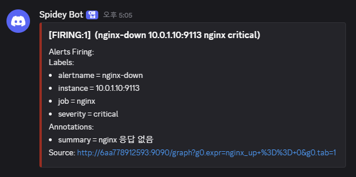
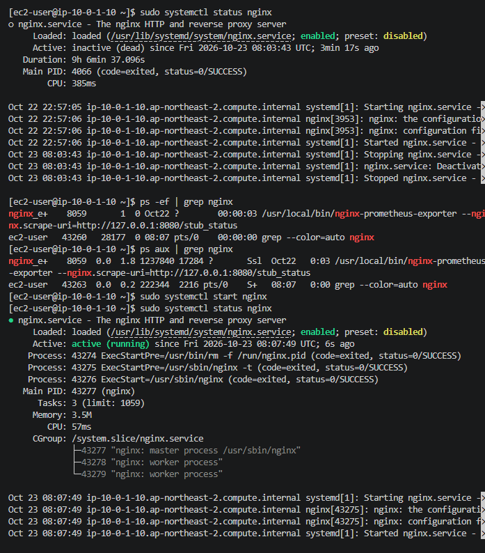
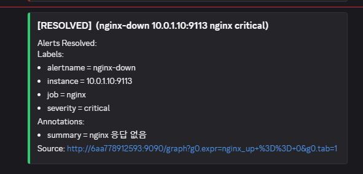
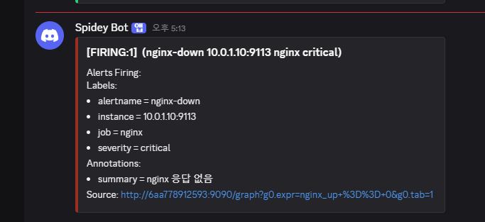
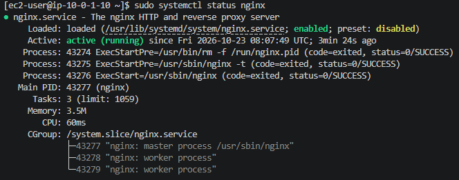
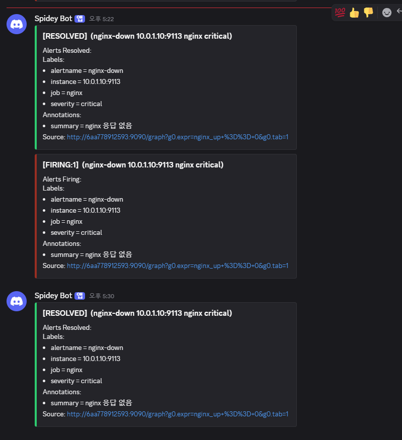

# 08. 홈페이지가 가끔 안 열림 (정리 작업이 nginx를 주기적으로 중지)

| 항목 | 내용 |
|---|---|
| 대상 서버 | `linux-ec2` (사설 IP 10.0.1.10, Amazon Linux 2023) |
| 발생 시각 | 2026-10-23 17:03 KST (nginx 첫 중단 로그 08:03:43 UTC 기준) |
| 감지 | 17:05 Discord 알림 `nginx-down` (critical), **발생 후 2분** |
| 영향 | 웹사이트 접속 불가가 **몇 분 간격으로 반복** |
| 상태 | 🟢 해결 (17:30 최종 RESOLVED, 발생 후 27분). 응급 복구 후 2회 재발 |

> 07번과 마찬가지로 알림으로 먼저 감지했습니다. 응급 복구만으로는 해결되지 않아 **재발**을 겪었고, 로그에서 주기적인 원인을 찾아 근본 조치했습니다.

## 상황

> 고객센터 문의:
> "홈페이지가 **가끔** 안 열려요. 새로고침하면 될 때도 있고요."
>
> 관제 알림 (Discord):
> `[FIRING:1] nginx-down 10.0.1.10:9113 nginx critical`
> "nginx 응답 없음"



| 라벨 | 값 | 뜻 |
|---|---|---|
| `alertname` | nginx-down | `nginx_up == 0` 규칙 |
| `instance` | `10.0.1.10:9113` | 웹서버의 nginx exporter가 "nginx가 응답하지 않는다"고 보고 |
| `severity` | critical | 서비스가 이미 멈춘 상태 |

07번의 교훈대로 **알림의 instance부터 읽고** 바로 웹서버로 접속했습니다.

## 해결 기록

> 캡처는 모두 장애 중에 직접 찍은 화면입니다. 서버 시각은 UTC입니다.

### 작성자 기록

| 항목 | 내용 |
|---|---|
| **원인** | 4분마다 실행되는 정리 작업(`housekeeping.timer` → `housekeeping.service`)의 스크립트 `/usr/local/sbin/housekeeping.sh` 첫 줄에 불필요한 `systemctl stop nginx`가 있어서, 캐시를 정리할 때마다 nginx를 끄고 다시 켜지 않음 |
| **확인한 명령어** | `systemctl status nginx`로 `status=0/SUCCESS`(고장이 아니라 정상 종료) 확인 → `journalctl -u nginx`로 중단 시각이 일정함을 확인 → audit 로그 `auid=4294967295`로 사람이 아닌 자동 작업임을 확인 → 중단 순간의 전체 `journalctl`에서 `housekeeping.service` 발견 → `systemctl cat`, 스크립트 확인 |
| **조치 내용** | 응급: `systemctl stop housekeeping.timer`로 반복 차단, `systemctl start nginx` → 근본: 스크립트 백업 후 `systemctl stop nginx` 줄 삭제 → 정리 작업을 직접 1회 실행해 nginx가 꺼지지 않는지 검증 → 타이머 재시작 |
| **재발 방지** | 캐시 파일은 nginx를 끄지 않아도 정리 가능하므로 stop 제거. nginx에 알려야 할 것이 있으면 stop 대신 `reload`. 60분 지난 캐시를 지우는데 4분마다 실행은 과하므로 주기를 1시간 또는 하루로 조정 건의. 운영 스크립트 변경은 리뷰와 테스트 후 배포 |
| **배운 점** | 서비스를 살린 뒤에도 **"왜 꺼졌나"를 끝까지 확인**해야 함. `status=0/SUCCESS`와 고객의 "가끔"이 이미 주기적 원인을 가리키고 있었음. 로그를 볼 때는 서버 시간대부터 확인 |

### 타임라인

| 시각 (KST) | 단계 | 내용 |
|---|---|---|
| 17:03:43 | 발생 | nginx 중단 (로그 08:03:43 UTC) |
| 17:05 | **감지** | Discord `nginx-down` FIRING |
| 17:07 | 확인 | 웹서버 접속, `systemctl status nginx` → inactive, `status=0/SUCCESS` |
| 17:07:49 | 응급 복구 1 | `systemctl start nginx` → RESOLVED |
| 17:11:45 | **재발 1** | nginx 다시 중단 (로그 08:11:45 UTC) → 17:13 FIRING |
| 17:22:30 | 응급 복구 2 | `systemctl start nginx` → RESOLVED |
| 17:23경 | **재발 2** | 다시 FIRING |
| 17:26 | 원인 | 중단 순간의 로그에서 `housekeeping.service` 발견 |
| 17:29 | 조치 | 타이머 정지, 스크립트 수정, 검증, 타이머 재시작 |
| 17:30 | **복구** | Discord 최종 RESOLVED |

### 1단계. nginx가 어떻게 멈췄나

```bash
sudo systemctl status nginx
ps -ef | grep nginx
```



| 멈춘 방식 | status에 나오는 모습 |
|---|---|
| 프로그램이 고장 나서 죽음 | `failed`, `status=1/FAILURE`나 `signal=SEGV`, 에러 메시지 |
| 누군가 정상적으로 멈춤 | **`inactive (dead)`, `status=0/SUCCESS`, `Stopping nginx.service`** ← 이번 경우 |

- `ps` 결과에는 nginx exporter와 grep 자신만 있고, nginx 본체(master, worker) 프로세스가 없음
- 고장이 아니라 **누군가 nginx를 껐다**는 것이 첫 번째 단서

### 2단계. 응급 복구와 재발

critical 장애라 서비스부터 살렸습니다.

```bash
sudo systemctl start nginx
```



하지만 원인을 모르는 상태였고, 몇 분 뒤 같은 알림이 다시 왔습니다.





이때 status의 `preset: disabled`를 원인으로 오해해 enable을 고려했습니다. `preset`은 배포판의 **기본값**일 뿐이고, 실제 설정은 바로 앞의 `enabled`(이미 부팅 시 자동 시작)였습니다. 이번 장애는 재부팅과도 관계가 없었습니다.

### 3단계. 언제, 얼마나 자주 멈추나

```bash
sudo journalctl -u nginx --since "08:00" --no-pager | grep -E "Stopping|Started"
```

처음에는 `--since "17:00"`(한국 시간)으로 조회해서 `No entries`가 나왔습니다. **서버 시간대가 UTC**라서 미래 시각을 조회한 것이었습니다. `timedatectl`로 시간대를 확인하고 UTC로 다시 조회했습니다.

```
Oct 23 08:03:43 ... Stopping nginx.service ...
Oct 23 08:07:49 ... Started nginx.service ...    ← 내가 살림
Oct 23 08:11:45 ... Stopping nginx.service ...
Oct 23 08:22:30 ... Started nginx.service ...    ← 내가 살림
```

- 멈춘 시각이 초 단위까지 일정 → **정해진 간격으로 무언가가 끄고 있음**
- 이미 꺼진 동안의 중단 시도는 기록되지 않으므로, 실제 간격은 더 짧을 수 있음

같은 시각의 감사(audit) 로그:

```
SERVICE_STOP pid=1 uid=0 auid=4294967295 ... msg='unit=nginx comm="systemd" ... res=success'
```

- `auid`는 이 일을 시킨 로그인 사용자. **4294967295(-1)은 로그인한 사람이 없음** → 사람이 아니라 자동 작업

### 4단계. 그 순간 서버에서 무슨 일이 있었나

`-u`(특정 서비스) 없이 시각으로만 잘라서 서버 전체 기록을 봤습니다.

```bash
sudo journalctl --since "08:11:40" --until "08:11:50" --no-pager
```

```
08:11:45 systemd[1]: Starting housekeeping.service - Periodic web housekeeping...
08:11:45 systemd[1]: Stopping nginx.service - The nginx HTTP and reverse proxy server...
08:11:45 systemd[1]: Stopped nginx.service ...
08:11:45 housekeeping.sh[43465]: 2026-10-23 08:11:45 housekeeping done
08:11:45 systemd[1]: Finished housekeeping.service - Periodic web housekeeping.
```

**`housekeeping.service`가 시작되는 순간 nginx가 멈추고**, 정리 작업은 "done"을 남기고 끝납니다. nginx를 다시 켜지는 않습니다.

```bash
systemctl cat housekeeping.service       # ExecStart=/usr/local/sbin/housekeeping.sh
cat /usr/local/sbin/housekeeping.sh      # 첫 줄: systemctl stop nginx
systemctl list-timers --all | grep -i housekeeping
```

- 스크립트의 목적: 서버의 오래된 nginx 캐시(60분 초과)와 세션 파일(2시간 초과) 정리
- 실제 동작: 정리 전에 nginx를 끔 (정리에 필요 없는 동작)
- `housekeeping.timer`가 4분마다 이 작업을 실행

### 5단계. 조치와 검증

```bash
# 응급: 반복부터 차단
sudo systemctl stop housekeeping.timer
sudo systemctl start nginx

# 근본: 백업 후 원인 줄 삭제
sudo cp /usr/local/sbin/housekeeping.sh /usr/local/sbin/housekeeping.sh.bak
sudo sed -i '/systemctl stop nginx/d' /usr/local/sbin/housekeeping.sh

# 검증: 원인 작업을 일부러 실행해도 nginx가 살아 있는지
sudo systemctl start housekeeping.service
systemctl is-active nginx                 # active

# 정리 작업 자체는 필요하므로 타이머 재시작
sudo systemctl start housekeeping.timer
```

| 검토한 방법 | 결과 | 판단 |
|---|---|---|
| `stop`을 `start`로 교체 | 이미 켜진 nginx를 켜는, 아무 효과 없는 줄이 됨 | ❌ |
| 정리 후 `start` 추가 | 4분마다 몇 초씩 서비스가 끊김 | ⚠️ |
| **`stop` 줄 삭제** | 서비스를 끊지 않고 정리만 함 | ✅ 선택 |
| 정리 후 `reload` | 끊김 없이 nginx가 설정을 다시 읽음 | ✅ nginx에 알릴 것이 있을 때 |

4분을 기다리지 않고 **원인 작업을 직접 실행해서** 더 이상 nginx가 꺼지지 않음을 바로 증명했습니다.



## 회고

| 잘한 점 | 아쉬운 점과 개선 |
|---|---|
| 07번 교훈대로 알림의 instance를 먼저 읽어 바로 대상 서버로 접속 (07번: 5분 → 이번: 즉시) | 응급 복구 후 원인을 모른 채 두어 **2회 재발**. 서비스를 살린 직후 "왜 꺼졌나"로 바로 돌아갔어야 함 |
| 중단 시각의 패턴, audit의 `auid`로 "사람이 아닌 주기적 작업"까지 좁힘 | `status=0/SUCCESS`와 고객의 "가끔"이라는 단서를 처음에 지나침 → 조치 전에 화면에서 **단서 세 개를 먼저 적는** 습관 |
| 수정 후 원인 작업을 직접 실행해 재현 검증 | `preset: disabled`를 원인으로 오해 → status 화면의 각 항목 의미를 복습 |
| 스크립트 수정 전에 백업 | journalctl에 한국 시간을 넣어 `No entries` → `timedatectl`로 시간대부터 확인 |

**실무라면 추가로 할 일**
- 타이머 정지(응급)까지는 관제가 하고, 운영 스크립트 수정은 담당자에게 알리고 확인받은 뒤 진행
- 장애 중 서비스가 몇 분씩 반복해서 끊겼으므로, 고객센터에 장애 내용과 복구 시각을 공유

> 이 장애는 Claude가 만든 스크립트를 내용을 보지 않은 채 웹서버에서 실행해 발생시켰습니다. 진단과 해결은 알림과 로그만 보고 제가 직접 수행했습니다.
